# San Quentin

**San Quentin** é um jogo de aventura em modo texto (*text adventure*), criado por **Ricardo Augusto Mata Costa**, escrito originalmente em **MSX-BASIC 1** e publicado no número **79** da revista **Micro Sistemas** como uma listagem para digitação.

O jogador assume o papel de Scarp Lantra, um prisioneiro que pretende aproveitar um blecaute para escapar da penitenciária de San Quentin. A exploração e as ações são realizadas por comandos de texto: mover-se entre locais, examinar as possibilidades de fuga e usar os objetos encontrados fazem parte da aventura. O inventário tem capacidade limitada, e os objetos podem tanto ajudar quanto dificultar a fuga.

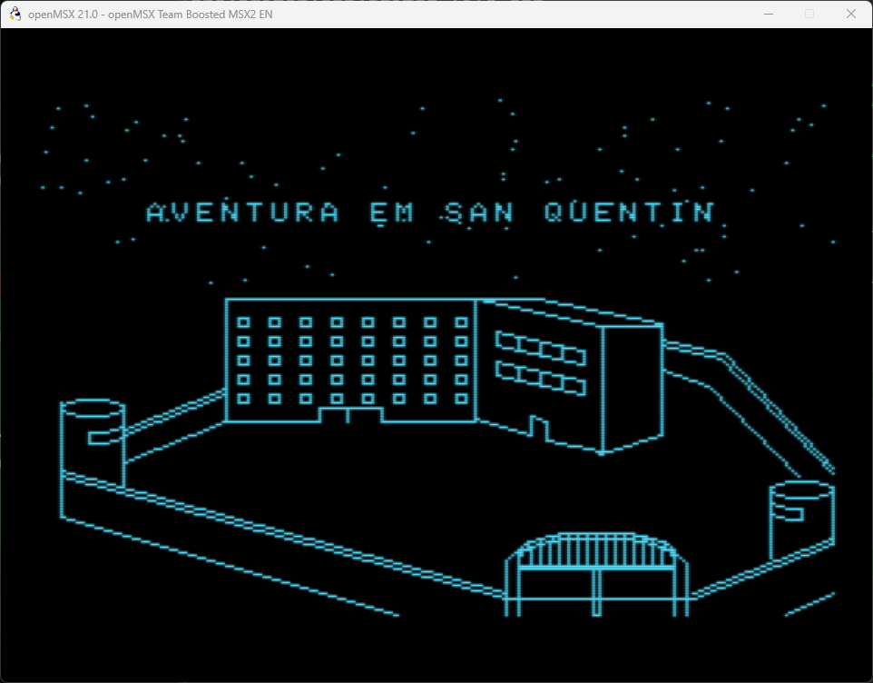

## Versões disponíveis — 1.1 / Danny Trejo

**Subtítulo:** Abertura MSX2 completa e baseline jogável MSX1.

**Estado:** pré-release de desenvolvimento, não uma versão final.

[Baixar o release 1.1](https://github.com/wilsonpilon/sanquentin/releases/tag/v1.1) ·
[Notas e limitações](docs/releases/1.1.md) ·
[Versionamento automático](docs/versioning.md)

| | MSX1 | MSX2 |
| --- | --- | --- |
| Objetivo | Conversão fiel ao BASIC original | Edição com apresentação ampliada |
| Estado em 1.1 | **Aventura jogável; fidelidade integral ainda em auditoria** | **Abertura concluída nesta fase; aventura ainda não integrada** |
| Vídeo | SCREEN 2 na abertura e SCREEN 0 no jogo | SCREEN 5, 256×212, 16 cores |
| Sistema | MSX-DOS 1; disco de 360 KB | MSX-DOS 2; disco de 720 KB |
| Memória | Validado no Sony HB-701FD; RAM mínima ainda não certificada | Mapper principal ≥512 KB, VRAM ≥128 KB |
| Recursos prontos | Parser, mapa, inventário, ações, guarda, mortes/fuga, RNG original | Dez quadros, introdução completa, persianas, blecaute, escolha S/N |
| Áudio | Sem trilha adicionada | PSG+FM previstos; música ainda não implementada |
| Próxima fase | Comparação integral de textos, glifos, entrada e ramos com o BASIC | Integrar a aventura e depois desenvolver áudio PSG/FM |

As duas compilações do release usam **`DEBUG=0`**. O MSX1 não inclui o
comando auxiliar `RESOLVER` nessa distribuição. A fuga já foi exercitada com
o auxiliar em builds de desenvolvimento; isso **não certifica equivalência
integral** com o BASIC. Nenhuma das edições foi certificada em hardware real.

### Capturas atuais do MSX1

Capturadas no openMSX/Sony HB-701FD a partir do executável **1.1**:

| Abertura SCREEN 2 | Introdução original |
| --- | --- |
| 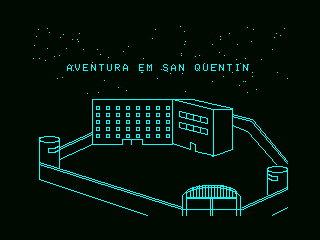 | 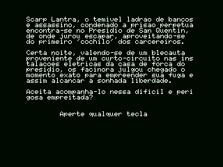 |
| **Cela jogável** | **Corredor após pegar a serra e serrar a grade** |
| 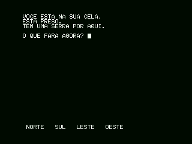 | 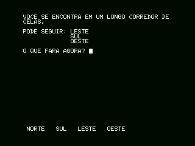 |

### Capturas atuais do MSX2

Capturadas no openMSX/Philips NMS 8250 com DOS2, mapper de 512 KB e FM-PAC,
a partir do executável **1.1**. As legendas “PAUSADO” nas capturas indicam
a pausa acionada pelo teste, não uma limitação da reprodução automática.

| Baía | Scarp Lantra na cela |
| --- | --- |
| 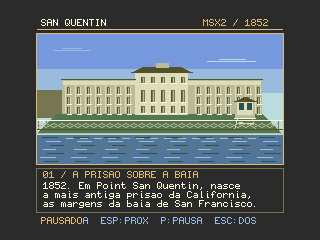 | 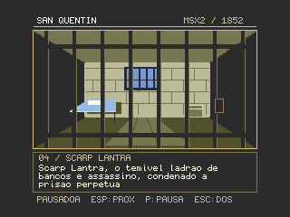 |
| **Casa de força antes da falha** | **Blecaute** |
| 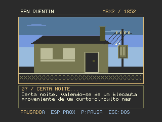 | 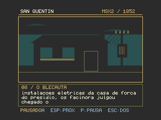 |

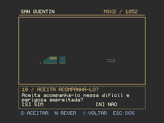

### Compilar ambas as edições

Na raiz do repositório:

```bat
build.bat
projects\msx1\run.bat
projects\msx2\run.bat
```

O primeiro build compartilhado gerou **1.1**. O próximo build bem-sucedido
gera **1.2**, depois **1.3**, sem editar números manualmente.
O comando `build.bat --milestone --codename "Nome" --subtitle "Recurso"`
abre o próximo marco em **2.1**. O número não é SemVer:
representa **marco.compilação**, com codinome por marco e subtítulo por build.
Veja [o fluxo completo](docs/versioning.md), inclusive geração do ZIP,
checksums, tag e publicação.

## O programa original

O programa e o artigo que o apresenta saíram originalmente no número **79** da revista **Micro Sistemas**. A versão em BASIC já foi digitada e está funcionando; ela serve como referência para a recriação.

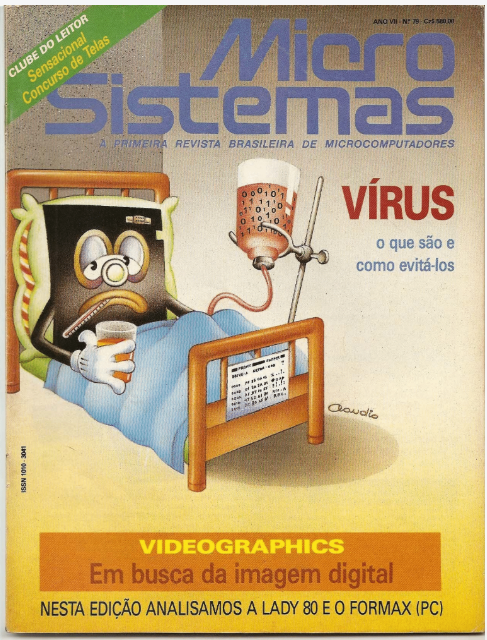

- [Artigo original transcrito em Markdown](ARTIGO.MD): apresentação da história e das instruções do jogo, sem a propaganda nem a listagem em BASIC.
- [Digitalização da publicação original](docs/SanQuentin.pdf).
- [Programa em BASIC](basic/QUENTIN.BAS).
- [Listagem em formato de texto](basic/quentin.asc).
- [Imagem de disquete do jogo](resource/SanQuentin.dsk).

## Recriação fiel

Em **2026**, **Wilson "Barney" Pilon** está recriando o jogo em C, preservando o comportamento do programa original em **MSX-BASIC 1**. O objetivo é reproduzir o jogo, não modernizar ou aprimorar suas regras, textos, apresentação ou funcionamento.

A implementação fiel é para **MSX1**, usando **SDCC** e **MSXgl**, como programa `.COM` para **MSX-DOS 1**. Em paralelo, foi iniciada uma edição **MSX2**, com apresentação própria, descrita abaixo; ela não altera a conversão fiel.

### Plataforma-alvo

- **Computador:** MSX1 ou superior, em modo compatível com MSX1.
- **Sistema operacional:** MSX-DOS 1.

### Ferramentas e tecnologias

| Ferramenta / tecnologia | Uso no projeto |
| --- | --- |
| MSX-BASIC 1 | Linguagem do jogo original, cuja lógica e comportamento devem ser reproduzidos. |
| SDCC | Compilador C da recriação. |
| MSXgl | Biblioteca de desenvolvimento para MSX usada na recriação. |
| MSX-DOS 1 | Ambiente de execução da recriação atual. |
| openMSX | Emulação do MSX para execução e testes. |

### Testar a fuga na conversão

Com `DEBUG=1`, digite `RESOLVER`
durante a partida. O próximo comando aparece no prompt; **Enter** o executa e
**Backspace** cancela a assistência. A rota é recalculada a cada passo usando
as posições atuais da lanterna, da chave, dos demais objetos e do guarda.
Os comandos passam pelo parser e pelo motor normais: não há teletransporte,
alteração de inventário nem proteção especial contra mortes. Se não conseguir
planejar a continuação, o assistente informa o motivo e devolve o controle.

O auxiliar é exclusivo de depuração. Os wrappers de build usam `DEBUG=0`
por padrão; o padrão interno em [sq_debug.h](src/sq_debug.h) permanece 1
para builds diretos de desenvolvimento. Para habilitar o auxiliar, no
Prompt de Comando, dentro de `projects\msx1`:

```bat
build.bat "define=DEBUG:1"
```

O roteiro manual está em [solution.md](docs/solution.md). Os testes host podem
ser executados por [run_solver_tests.bat](tests/run_solver_tests.bat),
[run_engine_tests.bat](tests/run_engine_tests.bat) e
[run_parser_tests.bat](tests/run_parser_tests.bat).
O RNG original e as coordenadas aleatórias da abertura são cobertos por
[run_random_tests.bat](tests/run_random_tests.bat), com checksum de valores
extraídos do MSX-BASIC 1.0. A reprodução do oráculo está documentada na
[especificação](SPEC.md#verificação-reproduzível-do-rng).

## Edição MSX2 — abertura histórica

A edição em [projects/msx2](projects/msx2) começa com uma abertura independente:
dez cards desenhados em tempo de execução, com vistas da baía, da fachada,
da torre/muralha, de uma cela fictícia e da casa de força. Os três primeiros
apresentam o contexto histórico; os sete seguintes contam a introdução
completa do jogo original e fazem a pergunta final. Mantém o espírito do desenho original,
mas usa **SCREEN 5, 256×212, 16 cores escolhidas entre 512**, áreas preenchidas,
sombras e linhas do V9938. Não carrega fotografias nem bitmaps das cenas:
as primitivas `Draw_Line`, `Draw_FillBox` e comandos de cópia do VDP fazem o
papel dos comandos gráficos/DRAW do BASIC. A fonte de texto vem do MSXgl.

### Plataforma e escopo

- **MSX2**, V9938 e **128 KB de VRAM**.
- **MSX-DOS 2** e **mapper principal de pelo menos 512 KB**; a abertura verifica
  a disponibilidade do mapper pelo DOS2 antes de entrar em modo gráfico.
- Plataforma sonora prevista: **PSG + MSX-MUSIC/FM (YM2413)**. O perfil de
  emulação já inclui FM-PAC, mas **esta abertura ainda não toca música**.
- Este primeiro executável apresenta somente o slideshow; ainda não executa
  a aventura MSX1. **Esc** retorna ao DOS.

Cada cena é montada na página 1 da VRAM enquanto a página 0 permanece visível.
O efeito de persianas revela a cena pronta em oito faixas horizontais.
O avanço automático ocorre após aproximadamente **12 segundos de leitura**,
além do tempo de desenho/transição. A sequência para na pergunta final:
ela não é respondida automaticamente. Nos quadros noturnos, as imagens
escurecem; na passagem para o blecaute, as luzes piscam brevemente e apagam.
As legendas permanecem legíveis.

| Tecla | Ação |
| --- | --- |
| Espaço, Enter ou seta direita | Próximo card, antes da pergunta final |
| Seta esquerda | Card anterior |
| P | Pausar/retomar o avanço automático |
| S, na pergunta final | Aceitar acompanhar Scarp Lantra |
| N, na pergunta final | Reiniciar o slideshow e retomar o avanço automático |
| Esc | Voltar ao MSX-DOS 2 |

A navegação manual continua funcionando em pausa. Seta esquerda no primeiro
card leva à pergunta final; na pergunta, seta esquerda permite reler a história.
Espaço, Enter e seta direita não substituem a escolha explícita de **S** ou **N**.
Ao aceitar, aparece a confirmação e o aviso de que a aventura MSX2 ainda está
em desenvolvimento. Nessa confirmação, **N** reinicia a abertura, enquanto
**Espaço/Enter/seta direita** ou **Esc** retornam ao DOS.

### Compilar e executar

Na raiz do repositório:

```bat
projects\msx2\build.bat
projects\msx2\run.bat
```

O build usa o SDCC/MSXgl já incluído e gera
`projects\msx2\emul\dsk\DOS2_quentin2.dsk` (720 KB), com `QUENTIN2.COM`
e os arquivos de inicialização do DOS2. O launcher usa o openMSX no PATH,
Philips NMS 8250, expansor de slots, DOS2, mapper de 512 KB e FM-PAC.
As ROMs dessa máquina e das extensões devem estar instaladas no openMSX;
não são fornecidas pelo projeto.
A configuração da biblioteca reaproveita a base MSX1 e sobrescreve apenas
as opções necessárias à edição MSX2, sem modificar o projeto MSX1.
Cada build individual também avança o contador compartilhado; para distribuir
as duas edições com o mesmo número, use o `build.bat` da raiz.

Após compilar, execute [run_msx2_intro_tests.bat](tests/run_msx2_intro_tests.bat)
para conferir a integridade do texto original, os limites das legendas e,
no emulador, os dez cards, modo/cores, transições, blecaute, pausa,
navegação, avanço automático, respostas S/N e retorno ao DOS. O teste gera capturas e
`intro-test.log` em `projects\msx2\out`.

### Referências e história

Os enquadramentos e elementos arquitetônicos foram estudados nas imagens
`reference*` locais da pasta [images](images); os desenhos são composições próprias,
não reproduções das fotografias. A cela é uma ilustração da ficção do jogo,
não uma reconstrução documental. As fotografias de referência não são
incluídas no release; as capturas publicadas são das telas geradas pelo jogo.

Os textos históricos são paráfrases dos fatos apresentados no
[artigo da ThoughtCo sobre San Quentin](https://www.thoughtco.com/san-quentin-104605):
fundação em 1852, localização em Point San Quentin, uso anterior do navio
Waban e construção com trabalho de detentos até 1854, no contexto posterior
à corrida do ouro. Não são usadas as estatísticas populacionais nem as
afirmações sobre a situação atual da prisão presentes no artigo.
Do quarto card em diante, o texto reproduz a introdução da aventura original,
das linhas 2380–2400 de [quentin.asc](basic/quentin.asc), integralmente e na
mesma ordem. Apenas os espaços de alinhamento do WIDTH 40 foram reorganizados
para as legendas; grafias do original, como "blecauta" e "os facinora", foram
mantidas. A antiga instrução "Aperte qualquer tecla" foi substituída pela escolha
**S/N**. A casa de força e o efeito de blecaute ilustram essa ficção, não eventos
da história real do presídio.

## Créditos

- **Autor original:** Ricardo Augusto Mata Costa, criador de San Quentin para a revista Micro Sistemas.
- **Publicação original:** número 79 da revista Micro Sistemas, onde foram publicados o artigo e a listagem do programa em MSX-BASIC 1.
- **Autor da nova versão:** Wilson "Barney" Pilon, 2026.
- **Biblioteca e fontes gráficas:** MSXgl, Guillaume "Aoineko" Blanchard,
  [CC BY-SA 4.0](MSXgl/LICENSE.md). A licença BSD do projeto não substitui
  as licenças dos componentes e conteúdos de terceiros.
- **Codinome do marco 1:** Danny Trejo, ex-detento de San Quentin; o nome
  identifica a série de desenvolvimento e não implica participação ou endosso.
