# San Quentin

**San Quentin** é um jogo de aventura em modo texto (*text adventure*), criado por **Ricardo Augusto Mata Costa**, escrito originalmente em **MSX-BASIC 1** e publicado no número **79** da revista **Micro Sistemas** como uma listagem para digitação.

O jogador assume o papel de Scarp Lantra, um prisioneiro que pretende aproveitar um blecaute para escapar da penitenciária de San Quentin. A exploração e as ações são realizadas por comandos de texto: mover-se entre locais, examinar as possibilidades de fuga e usar os objetos encontrados fazem parte da aventura. O inventário tem capacidade limitada, e os objetos podem tanto ajudar quanto dificultar a fuga.


## Versões disponíveis — 1.19 / Danny Trejo

**Subtítulo:** Aventura MSX2 ilustrada, trilha FM e PSG e discos duplos.

**Estado:** pré-release de desenvolvimento, não uma versão final.

[Baixar o release 1.19](https://github.com/wilsonpilon/sanquentin/releases/tag/v1.19) ·
[Notas e limitações](docs/releases/1.19.md) ·
[Versionamento automático](docs/versioning.md)

| | MSX1 | MSX2 |
| --- | --- | --- |
| Objetivo | Conversão fiel ao BASIC original | Edição com apresentação ampliada |
| Estado em 1.19 | **Aventura jogável; fidelidade integral ainda em auditoria** | **Aventura integrada e ilustrada; rotas completas na interface ainda em validação** |
| Vídeo | SCREEN 2 na abertura e SCREEN 0 no jogo | SCREEN 5, 256×212, 16 cores |
| Sistema | MSX-DOS 1; disco de 360 KB | MSX-DOS 2; disco de 720 KB |
| Memória | Validado no Sony HB-701FD; RAM mínima ainda não certificada | Mapper principal ≥512 KB, VRAM ≥128 KB |
| Recursos prontos | Parser, mapa, inventário, ações, guarda, mortes/fuga, RNG original | Abertura, motor compartilhado, três painéis, ambientes ilustrados e inventário com ícones |
| Áudio | Sem trilha adicionada | Trilha original em Mi menor, FM + percussão PSG, cerca de 2min08s |
| Próxima fase | Comparação integral de textos, glifos, entrada e ramos com o BASIC | Validar rotas completas na nova interface |

As duas compilações do release usam **`DEBUG=0`**. Nenhuma edição inclui o
comando auxiliar `RESOLVER` nessa distribuição. A fuga já foi exercitada com
o auxiliar em builds de desenvolvimento; isso **não certifica equivalência
integral** com o BASIC. Nenhuma das edições foi certificada em hardware real.

**Novidades desde 1.3:** aventura MSX2 ligada ao motor compartilhado,
interface em três painéis, miniaturas de todos os ambientes, inventário
com ícones e trilha de abertura mais longa, triste e pesada em FM + PSG.
Corrigidos áudio/temporização sob DOS2; os dois discos incluem agora os
dois programas. Também entram as correções de textos e lógica já
conferidas com a revista e o [mapa ilustrado](docs/mapa.md).
A validação diferencial compara 1.989 cenários BASIC × C, sem divergências
nos valores comparados; veja o [escopo e as limitações](docs/validation.md).

### Capturas atuais do MSX1

Capturadas no openMSX/Sony HB-701FD a partir do executável **1.19**.
A fonte nova aparece em SCREEN 0; a abertura SCREEN 2 foi preservada:

| Abertura SCREEN 2 | Introdução original |
| --- | --- |
| 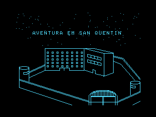 | 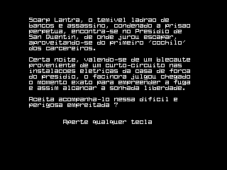 |
| **Cela jogável** | **Corredor após pegar a serra e serrar a grade** |
| 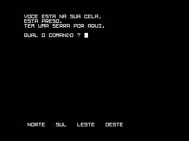 | 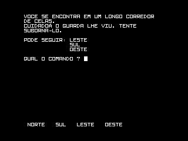 |

### Capturas atuais do MSX2

Capturadas no openMSX/Philips NMS 8250 com DOS2, mapper de 512 KB e FM-PAC,
a partir do executável **1.19**, com a fonte personalizada em SCREEN 5.
As legendas “PAUSADO” nas capturas indicam
a pausa acionada pelo teste, não uma limitação da reprodução automática.

| Baía | Scarp Lantra na cela |
| --- | --- |
| 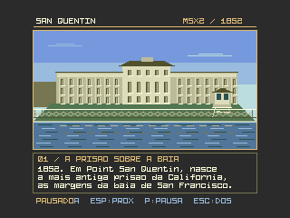 | 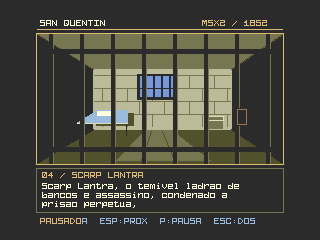 |
| **Casa de força antes da falha** | **Blecaute** |
|  | 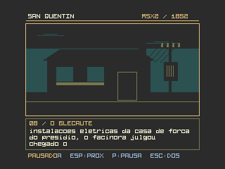 |

| Cela e inventário após pegar a serra | Corredor após serrar a grade |
| --- | --- |
| 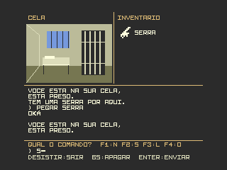 | 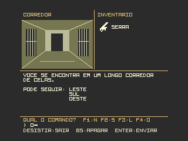 |
| **Biblioteca** | **Horta** |
| 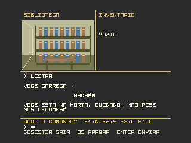 | 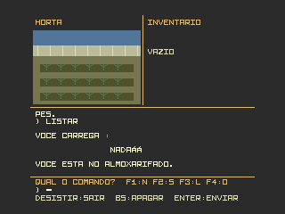 |

As capturas de biblioteca e horta usam estados injetados pelo teste visual,
não uma rota completa. Todas as 29 capturas de locais/variantes ficam no
[diretório do release](images/releases/1.19).

### Compilar ambas as edições

Na raiz do repositório:

```bat
build.bat
projects\msx1\run.bat
projects\msx2\run.bat
```

O primeiro build compartilhado gerou **1.1**. O release atual é **1.19**;
o próximo build bem-sucedido gera **1.20**, sem editar números manualmente.
O comando `build.bat --milestone --codename "Nome" --subtitle "Recurso"`
abre o próximo marco em **2.1**. O número não é SemVer:
representa **marco.compilação**, com codinome por marco e subtítulo por build.
Veja [o fluxo completo](docs/versioning.md), inclusive geração do ZIP,
checksums, tag e publicação.

### Dois programas em cada disco

Os discos gerados agora incluem **`QUENTIN.COM` (jogo MSX1)** e
**`QUENTIN2.COM` (abertura e aventura MSX2)**:

| Disco | Boot | Início automático |
| --- | --- | --- |
| `projects\msx1\emul\dsk\DOS1_quentin.dsk` (360 KB) | MSX-DOS 1 | `QUENTIN` |
| `projects\msx2\emul\dsk\DOS2_quentin2.dsk` (720 KB) | MSX-DOS 2 | `QUENTIN2` |

No prompt do DOS2, digite `QUENTIN` para jogar a edição MSX1; **Esc**
fecha a abertura MSX2 e retorna ao prompt. Na pergunta final, **S** inicia
a aventura MSX2; `DESISTIR` retorna ao DOS. `QUENTIN2` continua exigindo
MSX2, DOS2 e mapper de 512 KB: estar no disco DOS1 não remove esses requisitos.
Não há arquivos de dados externos necessários: fontes, gráficos, música
e dados do jogo estão incorporados nos COM.

Todos os atalhos de build, inclusive os de cada projeto, compilam as duas
edições e regeneram ambos os discos com a mesma versão.
Execute `tests\run_disk_tests.bat` após compilar para conferir os arquivos,
hashes e a execução do MSX1 pelo DOS2.

## O programa original

### Mapa e solução

- [Mapa do jogo](docs/mapa.md): diagrama das salas e ligações, objetos fixos,
  condições das passagens e nota sobre os objetos aleatórios (**spoilers**).
- [Roteiro de fuga](docs/solution.md) (**spoilers**).

O programa e o artigo que o apresenta saíram originalmente no número **79** da revista **Micro Sistemas**. A versão em BASIC já foi digitada e está funcionando; ela serve como referência para a recriação.


- [Artigo original transcrito em Markdown](ARTIGO.MD): apresentação da história e das instruções do jogo, sem a propaganda nem a listagem em BASIC.
- [Digitalização da publicação original](docs/SanQuentin.pdf).
- [Programa em BASIC](basic/QUENTIN.BAS).
- [Listagem em formato de texto](basic/quentin.asc).
- [Imagem de disquete do jogo](resource/SanQuentin.dsk).

## Recriação fiel

Em **2026**, **Wilson "Barney" Pilon** está recriando o jogo em C, preservando o comportamento do programa original em **MSX-BASIC 1**. O objetivo é reproduzir o jogo, não modernizar ou aprimorar suas regras, textos, apresentação ou funcionamento.

A implementação fiel é para **MSX1**, usando **SDCC** e **MSXgl**, como programa `.COM` para **MSX-DOS 1**. Em paralelo, foi iniciada uma edição **MSX2**, com apresentação própria, descrita abaixo; ela não altera a conversão fiel.

### Plataforma-alvo

- **Computador:** MSX1 ou superior, em modo compatível com MSX1.
- **Sistema operacional:** MSX-DOS 1.

### Correções de texto

A listagem disponível não é a digitação original do autor da recriação, e
continha erros de digitação. Ela foi conferida linha a linha com a
[listagem impressa na revista](docs/SanQuentin.pdf), e as diferenças foram
corrigidas na [listagem BASIC](basic/quentin.asc), no
[programa tokenizado](basic/QUENTIN.BAS) e na conversão em C, sem acentos e
sem mudar o estilo coloquial do autor (por exemplo, "O GUARDA LHE VIU").
A tela continua com 40 colunas: os espaços de alinhamento foram recalculados
para que nenhuma palavra seja cortada no fim da linha.

| Local | Listagem digitada | Revista (adotado) |
| --- | --- | --- |
| Introdução | `blecauta` | `blecaute` |
| Introdução | `os facinora julgou` | `o facinora julgou` |
| Introdução | `prisao perpetua encontra-se` | `prisao perpetua, encontra-se` |
| Introdução | `empreender sua fuga` | `empreender a fuga` |
| Introdução | `perigosa empreitada?` | `perigosa empreitada ?` |
| Livro | `HA UM LIVRO GROSSO AQUI.` | `HA UM LIVRO MUITO GROSSO AQUI.` |
| Guarda | `TESTE SUBORNALO.` | `TENTE SUBORNA-LO.` |
| Horta (sala 6) | `HORTA.CUIDADO` | `HORTA. CUIDADO` |
| Diretor (sala 13) | `NAO PARE, VOCE ESTA` | `NAO PARE, POIS VOCE ESTA` |
| Corredor (sala 14) | `...UM CORREDOR` | `...UM CORREDOR.` |
| Pátio (sala 15) | `HOLO-FOTES O DENUNCIARAO.` | `HOLOFOTES LHE DENUNCIARAO.` |
| Portão (sala 24) | `PORTAO DE SAIDA` | `PORTAO DE SAIDA!` |
| Prompt | `O QUE FARA AGORA?` | `QUAL O COMANDO ?` |
| `LISTAR` | `VOCE CARREGA:` | `VOCE CARREGA :` |
| Objeto que não tem | `VOCE NAO TEM!` | `VOCE NAO PODE <VERBO> O QUE NAO TEM.` |
| `NADAR` com a serra | `VOCE AFOGOU! A SERRA ERA MUITO PESADA!` | `VOCE SE AFOGOU! A SERRA QUE VOCE LEVAVA ERA MUITO PESADA.` |
| `CAVAR` com a escada | `QUE VOCE ENTALASSE` | `QUE VOCE SE ENTALASSE` |
| `CAVAR` sem colher | `VOCE MAO TEM A COLHER!` | `VOCE NAO TEM A COLHER!` |
| `ABRIR` com o osso | `LEVAVA. OS CAES` | `LEVAVA, OS CAES` |
| Guarda, sem objetos | `ELE O PRENDE.` | `ELE O PRENDE EM NOME DA LEI.` |
| `ACENDER`/`APAGAR` | `ISSO NAO ACENDE!`/`ISSO NAO APAGA!` | `ISSO NAO ACENDE.`/`ISSO NAO APAGA.` |
| Perguntas curtas | `ONDE?`, `O QUE?`, `COM O QUE?`, `MATAR QUEM?` | `ONDE ?`, `O QUE ?`, `COM O QUE ?`, `MATAR QUEM ?` |
| Final | `ACEITA OUTRA FUGA?` | `ACEITA OUTRA FUGA (S/N)?` |

Palavras que a listagem digitada cortava com hífen no fim da linha
(`ACE-SA`, `TEN-TE`, `OBJE- TOS`, `SUBOR- NAR`, `CASTIGA-DOS`) aparecem
inteiras, como na revista. Também foram corrigidos três desvios digitados
errados que mudavam o funcionamento:

- **`AJUDAR`** (linhas 1410 e 1420): `THEN420` e `TEN1450` tornavam as dicas
  inalcançáveis; agora, como na revista, o jogo responde
  `CERTOS OBJETOS CHAMAM MUITA ATENCAO!` no corredor (14) com a lanterna acesa,
  `VOCE NAO DEVIA TER ENTRADO AQUI SEM A LANTERNA!...` no necrotério (12) sem
  a lanterna, e `DESCULPE, NAO POSSO AJUDAR AGORA!` nos demais casos;
- **linha 960:** a mensagem usa o verbo digitado, como na revista;
- **linha 2350:** `E=0` em vez de um segundo `W=0`; sem efeito visível, pois
  o portão sempre é alcançado com leste desabilitado.

Foram mantidas diferenças em que a listagem digitada é melhor ou equivalente:
`JA ESTA APAGADA.` (a revista imprime `J EST APAGADA.`), `DO BEM, POIS`
(sem o espaço na revista) e a resposta a `ACEITA OUTRA FUGA (S/N)?`, que
aceita qualquer tecla (`S` reinicia) em vez de esperar `S` ou `N`.

### Ferramentas e tecnologias

| Ferramenta / tecnologia | Uso no projeto |
| --- | --- |
| MSX-BASIC 1 | Linguagem do jogo original, cuja lógica e comportamento devem ser reproduzidos. |
| SDCC | Compilador C da recriação. |
| MSXgl | Biblioteca de desenvolvimento para MSX usada na recriação. |
| MSX-DOS 1 / 2 | Ambiente de execução das edições MSX1 / MSX2. |
| openMSX | Emulação do MSX para execução e testes. |

### Fonte em SCREEN 0

A introdução e a aventura em SCREEN 0 usam a fonte fornecida em
[vram.dat](resource/vram.dat): 2.048 bytes, com 256 caracteres de oito bytes.
O build incorpora os padrões ao executável e os carrega na tabela de
caracteres da VRAM após a abertura em SCREEN 2, sem modificar o desenho
da abertura nem as regras e os textos do jogo. SCREEN 0 mostra os seis bits
mais à esquerda de cada linha dos glifos. Para experimentar outra fonte
com a mesma codificação, substitua o arquivo e recompile; tamanhos diferentes
são rejeitados. Esta é uma mudança visual autorizada em relação à fonte
anterior, não uma alegação de que a fonte pertence ao jogo Amazônia.

### Fonte bitmap no MSXgl

A abertura e a aventura MSX2 também usam [vram.dat](resource/vram.dat), via
`Print_SetBitmapFont(g_Font_VRAM)`, com avanço de **6×8 pixels** em SCREEN 5.
Isso substitui a fonte de exemplo do MSXgl, sem mudar textos ou coordenadas.
Os mesmos padrões monocromáticos servem para os modos bitmap SCREEN 5–8;
as cores são escolhidas por `Print_SetColor`, não pelo arquivo da fonte.
A integração atual foi validada em SCREEN 5.

O [conversor](tools/font.js) gera um cabeçalho C reutilizável, seguindo o
formato de [font_mgl_sample6.h](MSXgl/engine/content/font/font_mgl_sample6.h):

| Campo | Valor | Significado |
| --- | --- | --- |
| Byte 0 | `0x88` | Padrão de 8×8 pixels |
| Byte 1 | `0x68` | Avanço de 6 pixels na horizontal e 8 na vertical |
| Byte 2 | `0x00` | Primeiro código: 0 |
| Byte 3 | `0xFE` | Último código declarado: 254 |
| Restante | 2.048 bytes | 256 padrões, oito linhas por caractere, bit 7 à esquerda |

O limite declarado segue as fontes BIOS do MSXgl: `CharCount` é `u8` e
não comporta 256. O padrão 255 permanece no cabeçalho como dado adicional;
o carregador SCREEN 0 o envia separadamente. Ele é vazio no arquivo atual.
Em bitmap, o intervalo declarado é 0–254. Não há recodificação de caracteres
nem alteração dos padrões. Alguns símbolos usam os oito bits; com
`PRINT_WIDTH_6`, somente os seis à esquerda são desenhados. Para exibir os
oito, uma integração deve usar `PRINT_WIDTH_8` e avanço `0x88`, revendo o layout.

Os pré-builds geram `out\font_vram.h` em cada projeto. Para gerar manualmente:

```bat
node tools\font.js msx1
node tools\font.js msx2
node tests\test_font.js
```

O cabeçalho define `const unsigned char g_Font_VRAM[]`. Inclua-o em apenas
uma unidade C e, após selecionar o modo de vídeo, chame
`Print_SetBitmapFont(g_Font_VRAM)`. Habilite `PRINT_USE_BITMAP`, o modo VDP
desejado, `PRINT_WIDTH_6` e `PRINT_HEIGHT_8` na configuração do MSXgl.
As dimensões da tela não redimensionam os glifos automaticamente.
O [teste da abertura MSX2](tests/capture_msx2_intro.tcl) compara os pixels
do título em VRAM com o arquivo original, incluindo avanço e cores.

### Testar a fuga na conversão

Com `DEBUG=1`, digite `RESOLVER`
durante a partida. O próximo comando aparece no prompt; **Enter** o executa e
**Backspace** cancela a assistência. A rota é recalculada a cada passo usando
as posições atuais da lanterna, da chave, dos demais objetos e do guarda.
Os comandos passam pelo parser e pelo motor normais: não há teletransporte,
alteração de inventário nem proteção especial contra mortes. Se não conseguir
planejar a continuação, o assistente informa o motivo e devolve o controle.

O auxiliar é exclusivo de depuração. Os wrappers de build usam `DEBUG=0`
por padrão; o padrão interno em [sq_debug.h](src/sq_debug.h) permanece 1
para builds diretos de desenvolvimento. Para habilitar o auxiliar, no
Prompt de Comando, dentro de `projects\msx1`:

```bat
build.bat "define=DEBUG:1"
```

O roteiro manual está em [solution.md](docs/solution.md). Os testes host podem
ser executados por [run_solver_tests.bat](tests/run_solver_tests.bat),
[run_engine_tests.bat](tests/run_engine_tests.bat) e
[run_parser_tests.bat](tests/run_parser_tests.bat).
O RNG original e as coordenadas aleatórias da abertura são cobertos por
[run_random_tests.bat](tests/run_random_tests.bat), com checksum de valores
extraídos do MSX-BASIC 1.0. A reprodução do oráculo está documentada na
[especificação](SPEC.md#verificação-reproduzível-do-rng).

### Matriz automatizada BASIC x C

Execute `tests\run_differential_tests.bat` para comparar cenários de parser,
mapa, inventário, ações e guarda com a listagem original executada no
MSX-BASIC 1.0/openMSX. A suíte compara estados e encerramento, controla o
relógio aleatório e gera um relatório de divergências e linhas alcançadas.
Não recompila os jogos nem incrementa a versão.

Consulte a [matriz de validação](docs/validation.md) para os requisitos,
funcionamento e limites. Transcrições, fidelidade visual, sequências completas
e hardware real continuam sendo etapas separadas; aprovação da matriz não
certifica equivalência integral.

## Edição MSX2 — abertura musical e aventura ilustrada

A edição em [projects/msx2](projects/msx2) começa com uma abertura independente:
dez cards desenhados em tempo de execução, com vistas da baía, da fachada,
da torre/muralha, de uma cela fictícia e da casa de força. Os três primeiros
apresentam o contexto histórico; os sete seguintes contam a introdução
completa do jogo original e fazem a pergunta final. Mantém o espírito do desenho original,
mas usa **SCREEN 5, 256×212, 16 cores escolhidas entre 512**, áreas preenchidas,
sombras e linhas do V9938. Não carrega fotografias nem bitmaps das cenas:
as primitivas `Draw_Line`, `Draw_FillBox` e comandos de cópia do VDP fazem o
papel dos comandos gráficos/DRAW do BASIC. A fonte personalizada é desenhada
pelo módulo de impressão do MSXgl.

### Plataforma e escopo

- **MSX2**, V9938 e **128 KB de VRAM**.
- **MSX-DOS 2** e **mapper principal de pelo menos 512 KB**; a abertura verifica
  a disponibilidade do mapper pelo DOS2 antes de entrar em modo gráfico.
- Trilha original lenta e sombria em **Mi menor**, a 60 BPM: 32 compassos,
  aproximadamente **2min08s**, com quatro seções e desenvolvimento melódico.
  **MSX-MUSIC/FM (YM2413)** fornece guitarra elétrica, baixo e harmonias;
  o **PSG** toca bumbo grave, caixa e pratos, com percussão mais forte.
  O perfil de emulação inclui FM-PAC. Sem FM, permanece somente a percussão.
  A trilha continua durante desenhos, transições e pausas; repete apenas
  após a composição inteira e para ao retornar ao DOS.
- **S** na pergunta final inicia a aventura com o mesmo parser, motor,
  aleatoriedade e mensagens da edição MSX1. **Esc** na abertura retorna ao DOS.

### Aventura ilustrada em três painéis

- **Superior esquerdo:** miniatura própria de cada ambiente: corredores
  distintos, mesa com pratos, camas da enfermaria, caixas, canteiros,
  livros, visitas, fogão, capela, túnel, necrotério, escritório, pátio,
  oficina, rio, guaritas, cela surda, lavanderia e portão. A cela mantém
  a serra no chão e a grade que muda após `SERRAR`. O necrotério só revela
  detalhes com a lanterna carregada e acesa; passagens do túnel seguem
  as condições do motor.
- **Superior direito:** até três objetos carregados, com ícones de 16×16
  pixels e nomes. Pegar, largar e perder objetos atualiza o painel.
- **Inferior:** histórico textual de nove linhas em 40 colunas, com scroll
  restrito à área de mensagens; prompt e entrada permanecem fixos.
- **Enter** envia, **Backspace** apaga e **F1/F2/F3/F4** enviam
  Norte/Sul/Leste/Oeste. `DESISTIR` encerra e retorna ao DOS.

A música da abertura termina ao entrar na aventura. As regras não foram
reescritas; apenas a apresentação foi separada em backends MSX1 e MSX2.
O primeiro roteiro validado é `PEGAR SERRA`, `SERRAR`, `LESTE`, `OESTE`,
`LARGAR SERRA`. A validação de rotas completas pela interface MSX2
continua pendente.

Na abertura, cada cena é montada na página 1 da VRAM enquanto a página 0 permanece visível.
O efeito de persianas revela a cena pronta em oito faixas horizontais.
O avanço automático ocorre após aproximadamente **12 segundos de leitura**,
além do tempo de desenho/transição. A sequência para na pergunta final:
ela não é respondida automaticamente. Nos quadros noturnos, as imagens
escurecem; na passagem para o blecaute, as luzes piscam brevemente e apagam.
As legendas permanecem legíveis.

| Tecla | Ação |
| --- | --- |
| Espaço, Enter ou seta direita | Próximo card, antes da pergunta final |
| Seta esquerda | Card anterior |
| P | Pausar/retomar o avanço automático |
| S, na pergunta final | Iniciar a aventura |
| N, na pergunta final | Reiniciar o slideshow e retomar o avanço automático |
| Esc | Voltar ao MSX-DOS 2 |

A navegação manual continua funcionando em pausa. Seta esquerda no primeiro
card leva à pergunta final; na pergunta, seta esquerda permite reler a história.
Espaço, Enter e seta direita não substituem a escolha explícita de **S** ou **N**.
Ao aceitar, a abertura termina e o jogo começa na cela.

### Compilar e executar

Na raiz do repositório:

```bat
projects\msx2\build.bat
projects\msx2\run.bat
```

O build usa o SDCC/MSXgl já incluído e gera
`projects\msx2\emul\dsk\DOS2_quentin2.dsk` (720 KB), com `QUENTIN.COM`,
`QUENTIN2.COM` e os arquivos de inicialização do DOS2. O launcher usa o openMSX no PATH,
Philips NMS 8250, expansor de slots, DOS2, mapper de 512 KB e FM-PAC.
As ROMs dessa máquina e das extensões devem estar instaladas no openMSX;
não são fornecidas pelo projeto.
A configuração da biblioteca reaproveita a base MSX1 e sobrescreve apenas
as opções necessárias à edição MSX2, sem modificar o projeto MSX1.
Esse atalho também compila MSX1 e atualiza o disco DOS1; todos os builds
versionados mantêm ambos os programas e discos na mesma versão.

Após compilar, execute [run_msx2_intro_tests.bat](tests/run_msx2_intro_tests.bat)
para conferir a integridade do texto original, os limites das legendas e,
no emulador, os dez cards, modo/cores, transições, blecaute, pausa,
navegação, avanço automático, respostas S/N e retorno ao DOS. O teste gera capturas e
`intro-test.log` em `projects\msx2\out`.
Execute também [run_msx2_game_tests.bat](tests/run_msx2_game_tests.bat)
para validar os painéis, inventário, edição com Backspace, movimento por F3,
grade serrada e retorno funcional ao DOS. As capturas `game-*.png`
e o log ficam no mesmo diretório de saída.
O teste [run_msx2_rooms_tests.bat](tests/run_msx2_rooms_tests.bat) percorre
24 estados de local e cinco variantes de iluminação/escavação, verifica
diferenças gráficas sem contar os títulos e preservação dos demais painéis,
e grava `room-*.png` e `rooms-test.log` no mesmo diretório.
Ele injeta estados apenas no emulador para testar o desenho: não certifica
que esses estados foram alcançados pelas rotas do jogo.

### Referências e história

Os enquadramentos e elementos arquitetônicos foram estudados nas imagens
`reference*` locais da pasta [images](images); os desenhos são composições próprias,
não reproduções das fotografias. A cela é uma ilustração da ficção do jogo,
não uma reconstrução documental. As fotografias de referência não são
incluídas no release; as capturas publicadas são das telas geradas pelo jogo.

Os textos históricos são paráfrases dos fatos apresentados no
[artigo da ThoughtCo sobre San Quentin](https://www.thoughtco.com/san-quentin-104605):
fundação em 1852, localização em Point San Quentin, uso anterior do navio
Waban e construção com trabalho de detentos até 1854, no contexto posterior
à corrida do ouro. Não são usadas as estatísticas populacionais nem as
afirmações sobre a situação atual da prisão presentes no artigo.
Do quarto card em diante, o texto reproduz a introdução da aventura original,
das linhas 2380–2400 de [quentin.asc](basic/quentin.asc), integralmente e na
mesma ordem. Os espaços de alinhamento do WIDTH 40 foram reorganizados
para as legendas, e o texto segue a revista, como no MSX1
(veja [Correções de texto](#correções-de-texto)). A antiga instrução "Aperte qualquer tecla" foi substituída pela escolha
**S/N**. A casa de força e o efeito de blecaute ilustram essa ficção, não eventos
da história real do presídio.

## Créditos

- **Autor original:** Ricardo Augusto Mata Costa, criador de San Quentin para a revista Micro Sistemas.
- **Publicação original:** número 79 da revista Micro Sistemas, onde foram publicados o artigo e a listagem do programa em MSX-BASIC 1.
- **Autor da nova versão:** Wilson "Barney" Pilon, 2026.
- **Biblioteca e fontes gráficas:** MSXgl, Guillaume "Aoineko" Blanchard,
  [CC BY-SA 4.0](MSXgl/LICENSE.md). A licença BSD do projeto não substitui
  as licenças dos componentes e conteúdos de terceiros.
- **Codinome do marco 1:** Danny Trejo, ex-detento de San Quentin; o nome
  identifica a série de desenvolvimento e não implica participação ou endosso.
