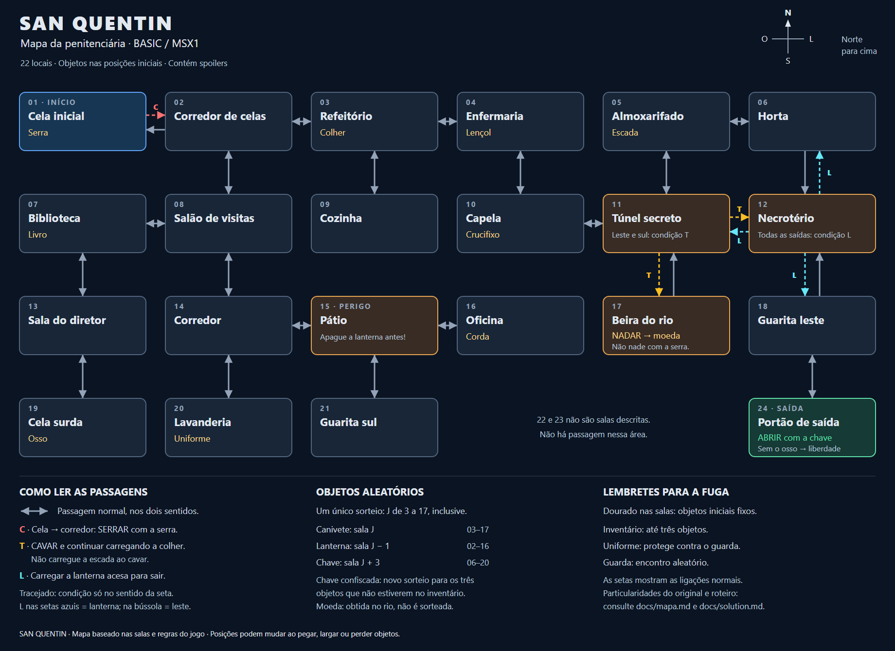
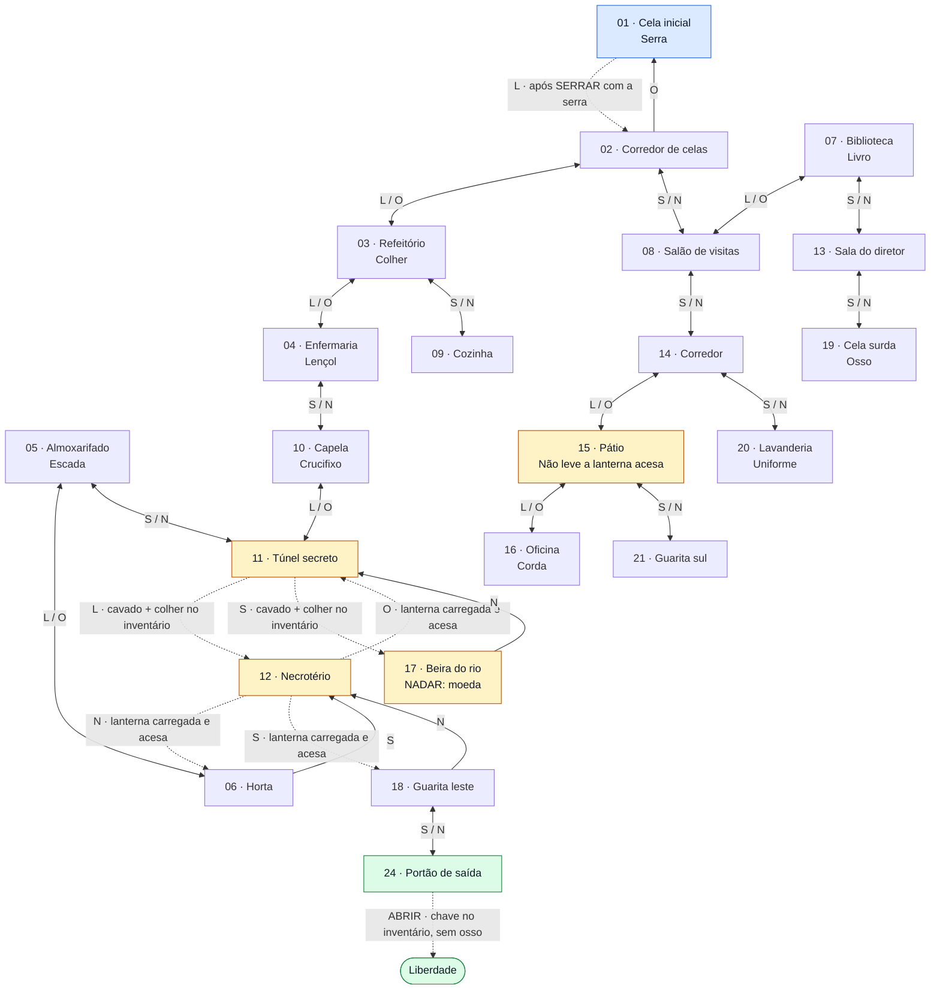

# San Quentin — mapa do jogo

> **Spoilers:** salas, objetos, passagens secretas e condições de fuga.

Mapa da aventura original em BASIC e do motor C compartilhado pelas edições
MSX1 e MSX2. A apresentação gráfica do MSX2 não altera ligações nem condições.
Os desenhos são miniaturas ilustrativas, não plantas das saídas.
Os números são os identificadores dos locais no jogo, não a ordem de visita.
Os objetos indicados nas salas têm **posição inicial fixa**: depois de pegá-los,
deixá-los ou de um encontro com o guarda, sua localização pode mudar.

## Mapa gráfico

[Abrir PNG em tamanho original](../images/sanquentin-mapa.png) ·
[Abrir SVG vetorial para ampliar ou imprimir](../images/sanquentin-mapa.svg).

No desenho, **norte fica para cima e leste para a direita**. As setas
tracejadas destacam as condições em cada sentido, detalhadas na legenda.
Os objetos aleatórios e os principais perigos aparecem nas notas inferiores.

## Diagrama Mermaid

As ligações são esquemáticas, não uma planta em escala. **Use as direções
escritas nas setas**, não a posição visual dos blocos.

- **N** = norte; **S** = sul; **L** = leste; **O** = oeste.
- Nas setas duplas, `L / O` significa ir para o segundo local por leste e
  voltar por oeste; `S / N` segue a mesma convenção.
- Setas pontilhadas indicam uma condição para atravessar **naquele sentido**.
- A moeda aparece no rio por uma ação, não fica no chão.

## Salas, saídas e objetos fixos

Esta tabela também permite consultar o mapa sem um visualizador Mermaid.
As condições das saídas marcadas com `*` estão descritas logo abaixo.

| Nº | Local | Saídas | Objeto inicial fixo |
| --- | --- | --- | --- |
| 01 | Cela inicial | L → 02 `*` | Serra |
| 02 | Corredor de celas | L → 03; S → 08; O → 01 | — |
| 03 | Refeitório | L → 04; S → 09; O → 02 | Colher |
| 04 | Enfermaria | S → 10; O → 03 | Lençol |
| 05 | Almoxarifado | L → 06; S → 11 | Escada |
| 06 | Horta | S → 12; O → 05 | — |
| 07 | Biblioteca | L → 08; S → 13 | Livro |
| 08 | Salão de visitas | N → 02; S → 14; O → 07 | — |
| 09 | Cozinha | N → 03 | — |
| 10 | Capela | N → 04; L → 11 | Crucifixo |
| 11 | Túnel secreto | N → 05; O → 10; L → 12 `*`; S → 17 `*` | — |
| 12 | Necrotério | N → 06 `*`; S → 18 `*`; O → 11 `*` | — |
| 13 | Sala do diretor | N → 07; S → 19 | — |
| 14 | Corredor | N → 08; L → 15; S → 20 | — |
| 15 | Pátio | L → 16; S → 21; O → 14 | — |
| 16 | Oficina | O → 15 | Corda |
| 17 | Beira do rio | N → 11 | Moeda obtida com `NADAR` |
| 18 | Guarita leste | N → 12; S → 24 | — |
| 19 | Cela surda | N → 13 | Osso |
| 20 | Lavanderia | N → 14 | Uniforme |
| 21 | Guarita sul | N → 15 | — |
| 24 | Portão de saída | N → 18; `ABRIR` para fugir `*` | — |

### Condições e perigos

1. **Cela:** use `PEGAR SERRA` e `SERRAR` para liberar a saída leste.
2. **Túnel:** use `CAVAR` carregando a colher, **sem carregar a escada**.
   Depois de cavar, as saídas leste e sul só continuam disponíveis enquanto
   a colher estiver no inventário. Norte e oeste não dependem dela.
3. **Necrotério:** suas três saídas exigem a lanterna **no inventário e acesa**.
   É possível entrar sem ela, mas não sair até satisfazer essa condição.
   A entrada pela horta não exige cavar o túnel.
4. **Pátio:** entrar carregando a lanterna acesa leva à morte na próxima
   avaliação de comando; apague-a **antes** de entrar.
5. **Rio:** `NADAR` entrega a moeda diretamente ao inventário e não leva a
   outra sala. Nadar carregando a serra causa afogamento.
6. **Portão:** use `ABRIR` com a chave no inventário. Se carregar o osso,
   os cães farejam você e a fuga fracassa.
7. **Guarda:** pode aparecer durante a exploração. Carregar o uniforme
   evita o confisco; sem ele, o guarda pode tomar um objeto carregado.
   Sem nenhum objeto, você é preso.

## Nota sobre os objetos aleatórios

**Canivete, lanterna e chave não têm sala fixa**, mas suas posições iniciais
também não são sorteadas de forma independente. O jogo sorteia um único
número inteiro **J entre 3 e 17**, inclusive:

| Objeto | Sala inicial | Faixa possível |
| --- | --- | --- |
| Canivete | J | 03 a 17 |
| Lanterna | J − 1 | 02 a 16 |
| Chave | J + 3 | 06 a 20 |

Por exemplo, se o canivete começar na **11 (túnel)**, a lanterna começa na
**10 (capela)** e a chave na **14 (corredor)**. São relações entre os
**números das salas**, não distâncias percorridas pelo mapa.

Se o guarda confiscar a **chave**, ocorre um novo sorteio com as mesmas
fórmulas. Cada um desses três objetos que **não estiver no inventário**
é reposicionado; os que você já carrega permanecem com você.
Assim, as relações acima descrevem a distribuição inicial e os objetos
reposicionados juntos, não necessariamente as posições atuais depois de
pegar, largar ou perder itens.

A **moeda não é sorteada**: ela é obtida nadando na sala 17.
O **guarda** é um encontro aleatório, não um objeto fixo em uma sala.

## Particularidades preservadas do original

- Existem **22 locais com descrição**: 01–21 e 24. Os números 22 e 23
  não representam salas descritas nem fazem parte das ligações normais.
- No portão (24), a listagem digitada atribuía oeste duas vezes e não
  redefinia leste. A revista traz `E=0`, e a listagem e a conversão em C
  foram corrigidas. Na chegada normal, pelo sul da guarita leste (18), leste
  já estava desabilitado, então não havia diferença visível.

## Referências

- [Roteiro de fuga](solution.md).
- [Listagem BASIC](../basic/quentin.asc): objetos nas linhas 210–400,
  movimento nas linhas 680–710 e salas nas linhas 1690–2350.
- [Motor em C](../src/sq_engine.c): objetos iniciais, sorteios, saídas e ações.
